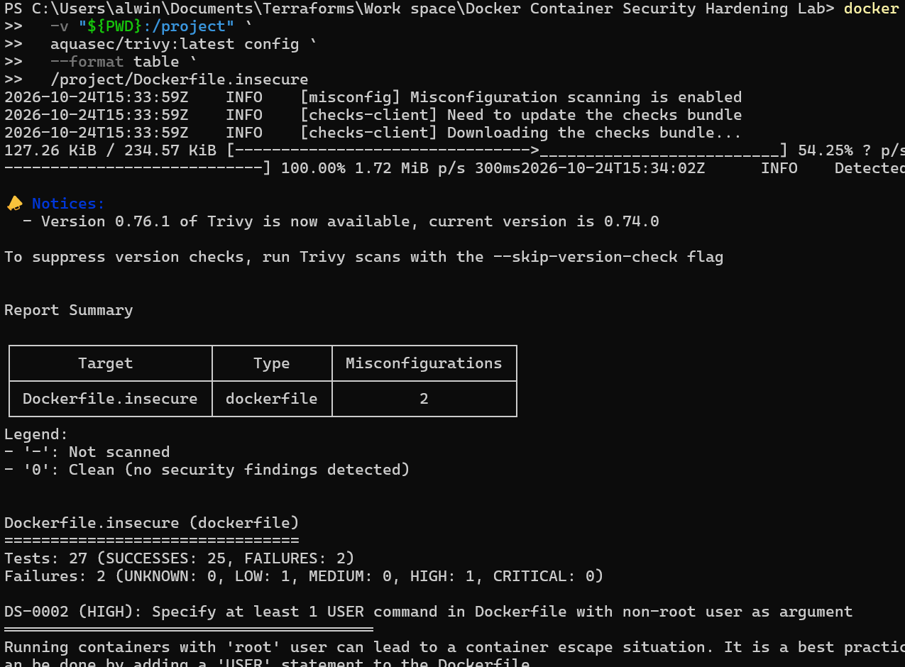
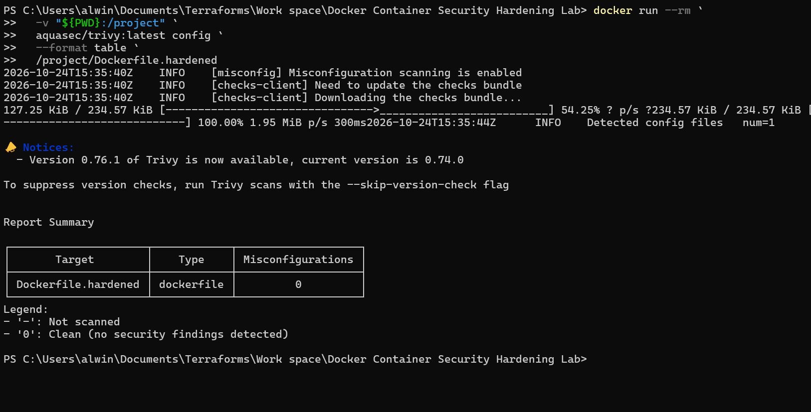
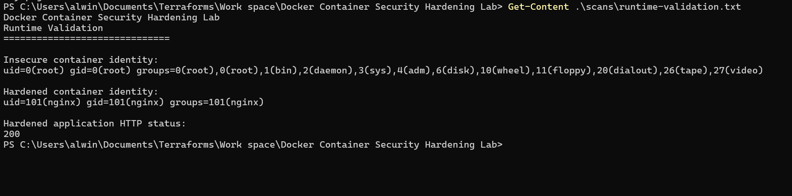

# Docker Container Security Hardening Lab

## Overview

A hands-on Docker security assessment comparing an insecure NGINX container with a hardened version. The lab uses Trivy to scan Dockerfiles and container images, applies least-privilege configuration, and validates runtime behavior.

## Objectives

- Identify Dockerfile security misconfigurations.
- Harden an NGINX container using non-root execution and a health check.
- Scan container images and Dockerfiles using Trivy.
- Validate container identity and application availability.
- Preserve security scan reports and runtime evidence.

## Technology Stack

- Docker
- NGINX
- Alpine Linux
- Trivy
- PowerShell

## Security Findings

### Baseline

Trivy detected two Dockerfile misconfigurations:

| ID | Severity | Finding |
|---|---|---|
| DS-0002 | HIGH | No non-root `USER` instruction |
| DS-0026 | LOW | No `HEALTHCHECK` instruction |

Runtime inspection confirmed that the baseline container ran as UID 0 (`root`).

### Hardening measures

- Updated Alpine packages during the image build.
- Configured NGINX to run as UID 101 (`nginx`).
- Added a Docker `HEALTHCHECK`.
- Configured NGINX temporary-file and PID paths under `/tmp`.
- Configured NGINX to listen on port 8080.

## Validation Results

| Test | Result |
|---|---|
| Baseline Dockerfile scan | 2 misconfigurations detected |
| Hardened Dockerfile scan | 0 misconfigurations detected |
| Hardened image scan | 0 vulnerabilities, misconfigurations, and secrets in the saved report |
| Baseline runtime identity | UID 0 (`root`) |
| Hardened runtime identity | UID 101 (`nginx`) |
| Hardened application response | HTTP 200 |

These results reflect the Trivy version and vulnerability database used during the scans. Zero findings do not guarantee the absence of every possible security issue.

## Evidence

### Baseline scan



### Hardened Dockerfile scan



### Runtime validation



Detailed reports are available in the `scans/` directory.

## Project Structure

```text
Docker Container Security Hardening Lab/
├── app/
│   └── index.html
├── evidence/
│   ├── baseline-trivy.png
│   ├── hardened-trivy.png
│   └── runtime-validation.png
├── scans/
│   ├── baseline-dockerfile-trivy.json
│   ├── baseline-image.json
│   ├── baseline-inspect.json
│   ├── baseline-trivy.json
│   ├── hardened-dockerfile-trivy.json
│   ├── hardened-trivy.json
│   └── runtime-validation.txt
├── Dockerfile.insecure
├── Dockerfile.hardened
├── nginx.conf
├── SECURITY-COMPARISON.md
└── README.md
```

## Reproducing the Lab

Run these commands from the project root.

### 1. Build the images

```powershell
docker build -f Dockerfile.insecure -t docker-security-lab:insecure .
docker build -f Dockerfile.hardened -t docker-security-lab:hardened .
```

### 2. Run the containers

```powershell
docker run -d --name docker-security-insecure -p 8080:80 docker-security-lab:insecure
docker run -d --name docker-security-hardened -p 8081:8080 docker-security-lab:hardened
```

If containers with these names already exist, remove or rename them before rerunning the commands.

### 3. Scan the Dockerfiles

```powershell
docker run --rm -v "${PWD}:/project" aquasec/trivy:latest config /project/Dockerfile.insecure
docker run --rm -v "${PWD}:/project" aquasec/trivy:latest config /project/Dockerfile.hardened
```

### 4. Scan the images

```powershell
docker run --rm -v /var/run/docker.sock:/var/run/docker.sock aquasec/trivy:latest image docker-security-lab:insecure
docker run --rm -v /var/run/docker.sock:/var/run/docker.sock aquasec/trivy:latest image docker-security-lab:hardened
```

### 5. Validate runtime behavior

```powershell
docker exec docker-security-insecure id
docker exec docker-security-hardened id
Invoke-WebRequest http://localhost:8081 -UseBasicParsing
```

Expected identity difference: the baseline runs as root, while the hardened container runs as the `nginx` user. The hardened application should return HTTP 200.

## Conclusion

This lab demonstrates practical container security assessment, Dockerfile hardening, Trivy scanning, least-privilege execution, health checks, and runtime validation through a documented before-and-after comparison.


## Why Non-Root Containers Matter

Running an application as a non-root user follows the principle of least privilege. If an attacker exploits a vulnerability inside the container, the application process has fewer privileges than a process running as root. In this lab, the baseline NGINX container runs as UID 0, while the hardened container runs as UID 101 (`nginx`). This reduces unnecessary privileges and demonstrates a practical container security control.

## Interpreting Scan Results

A scan with zero findings does not guarantee that a container is completely secure. Results depend on the scanner version, vulnerability database, enabled checks, and scan configuration. This lab combines Trivy results with runtime identity and HTTP response checks to provide a more useful before-and-after assessment.
